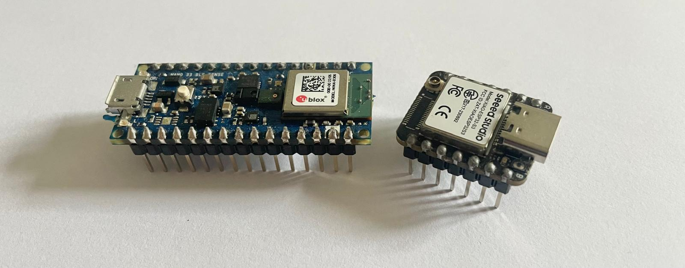

# AIoT Engineering

**13 hands-on labs, one per chapter, for building AI-powered IoT systems from the sensor up to the cloud.**

This is the companion lab repository for *AIoT Engineering* by Walid Abdaoui, published by Elektor. Each lab is full runnable code: Docker stacks, real firmware for real boards, and a step-by-step procedure with expected output at every stage. Read this page before starting any lab.

## Contents

- [Before you start: prerequisites](#before-you-start-prerequisites)
- [Startup tutorials](#startup-tutorials)
- [Technology deep-dives](#technology-deep-dives)
- [Labs 1 to 13](#labs-1-to-13)
- [Conventions](#conventions)
- [Something is wrong](#something-is-wrong)
- [License](#license)

Every lab folder is self-contained: its own README, its own Docker Compose file or PlatformIO project, its own `tests/smoke.sh`. `cd` into a lab's folder and everything you need to run it is right there.

## Before you start: prerequisites

Docker, Python, Node.js, an ESP32-S3, a Nano 33 BLE Sense, a Raspberry Pi, depending on which labs you run. None of them are needed all at once, and no lab in Part I needs more than a laptop plus Docker.

**[See the full prerequisites and per-lab hardware/software list →](./docs/prerequisites.md)**

## Startup tutorials

Seven step-by-step tutorials, each covering Windows, macOS, and Linux. Do the ones your path through the labs needs, the [prerequisites page](./docs/prerequisites.md) tells you which.

| # | Tutorial | Covers |
| :---- | :---- | :---- |
| T1 | [Docker startup](./tutorials/docker-startup.md) | Docker Desktop (Windows/macOS) or Docker Engine plus Compose v2 (Linux). Verifying the install. Which shell to use on Windows. |
| T2 | [ESP32-S3 startup](./tutorials/esp32-s3-startup.md) | Driver and port detection, PlatformIO install, first flash. The fast path onto the chip. |
| T3 | [FreeRTOS for ESP32-S3 startup](./tutorials/freertos-esp32-s3-startup.md) | Installing raw ESP-IDF, the toolchain PlatformIO hides. What FreeRTOS actually gives you. Building and flashing with `idf.py`. |
| T4 | [Raspberry Pi startup](./tutorials/raspberrypi-startup.md) | Imaging the SD card headless, first SSH login, installing Docker on the Pi. |
| T5 | [Arduino Nano 33 BLE startup](./tutorials/arduino-nano33ble-startup.md) | Arduino IDE 2.x, the Mbed OS Nano board package, first upload, verifying the onboard IMU. |
| T6 | [Node-RED startup](./tutorials/nodered-startup.md) | Flows, nodes and Deploy explained, running Node-RED in Docker versus natively on the host, the Node-RED Dashboard, and a real config-node bug worth knowing about. |
| T7 | [Jetson Nano startup](./tutorials/jetson-nano-startup.md) | Flashing the SD card image, first boot with a monitor, SSH in, verifying the GPU with `tegrastats`/`jtop`, Docker with GPU passthrough. |

## Technology deep-dives

Not a per-OS startup guide, but a technical explainer for a technology used across the labs: how it works internally, its schemas, and the commands to operate it.

| Tutorial | Covers |
| :---- | :---- |
| [Data Processing Technologies](./tutorials/data-processing-technologies.md) | Redpanda: the Kafka wire protocol, partitions and Raft-based replication, the produce/fetch path, record schemas, and the `rpk` command reference. TimescaleDB: hypertables, chunks, retention, compression, and continuous aggregates. Used in Lab 6. |

## Labs 1 to 13

Each row links to that lab's own `README.md`, the full self-contained procedure with every command, every expected output, and its own troubleshooting table.

| Lab | Chapter | What you build | Folder |
| :--- | :--- | :--- | :--- |
| 1 | Chapter 1: IoT Platforms | Simulate IoT devices publishing MQTT telemetry, process the stream with Node-RED, store the latest state in Redis, and visualize it live with Streamlit. | [ch01-mosquitto-nodered/](./ch01-mosquitto-nodered/README.md) |
| 2 | Chapter 2: Hardware and Firmware | Run the same workload on a real ESP32-S3 using a polling super-loop and FreeRTOS, then measure how task priorities affect worst-case latency. | [ch02-rtos-latency/](./ch02-rtos-latency/README.md) |
| 3 | Chapter 3: Connectivity | Measure the real network cost of the same telemetry message over MQTT and HTTP, with and without TLS, using packet captures. | [ch03-mqtt-vs-http-cost/](./ch03-mqtt-vs-http-cost/README.md) |
| 4 | Chapter 4: IoT Security | Build a two-level PKI from scratch, issue a certificate to each device, establish mutual TLS, and test what happens when identity or authorization rules are broken. | [ch04-pki-security/](./ch04-pki-security/README.md) |
| 5 | Chapter 5: Edge Computing & Digital Twins | Build a Device Twin and close the loop between the platform's desired state and the device's reported state. | [ch05-edge-device-twin/](./ch05-edge-device-twin/README.md) |
| 6 | Chapter 6: AIoT Data-Intensive Systems | Stream real IMU measurements from an Arduino Nano 33 BLE Sense through USB and Node-RED into an event pipeline and TimescaleDB, then observe the data live. | [ch06-imu-streaming/](./ch06-imu-streaming/README.md) |
| 7 | Chapter 7: EDA and Dataset Preparation | Explore raw sensor data, detect missing values, outliers, imbalance, drift, and inconsistent samples, then produce a clean and reproducible dataset for the next chapters. | [ch07-eda-dataset-preparation/](./ch07-eda-dataset-preparation/README.md) |
| 8 | Chapter 8: Signal Processing and Feature Extraction | Record motion (still, tilt, shake) and spoken-word audio ("start", "stop") on a Nano 33 BLE Sense, then compare their waveforms, spectra, and features across repeated trials. | `to do` |
| 9 | Chapter 9: Machine Learning Fundamentals | Build transparent regression and classification models with exported parameters, reproduce inference in C, and test numerical parity. Specification only. | `to do` |
| 10 | Chapter 10: Building and Evaluating TinyML Models | Compare a conventional classifier with a small neural network on leakage-free sensor splits, extended with Isolation Forest. Specification only. | `to do` |
| 11 | Chapter 11: TinyML Runtimes and Model Optimization | Inspect graphs and tensors, create float and int8 model artifacts, and define a controlled LiteRT Micro benchmark on ESP32-S3. Specification only. | `to do` |
| 12 | Chapter 12: Embedded Inference and Deployment | Deploy the exact Lab 11 artifact to ESP32-S3, verify deterministic replay parity, and then exercise real acquisition. Specification only. | `to do` |
| 13 | Chapter 13: Edge MLOps | Build versioned model packages, reject an invalid update, and demonstrate recovery and rollback. Specification only. | `to do` |

## Conventions

Code is set in monospace in the book and lives here in full: every Dockerfile, config, script, and dashboard. Every lab ships a `tests/smoke.sh`. Run it bare for a fast structural check, or `FULL=1 ./tests/smoke.sh` to actually bring the stack up and verify it end to end. This is a good way to confirm your environment works before doing a lab by hand.

Numbers in this book are stated precisely on purpose. A lab's README prints a real measurement, not an illustrative round number, and says so when a number is from one run on one machine rather than a specification.

## Something is wrong

Every lab ships mistakes eventually. Found one? [Open an issue](../../issues) on this repository.

## License

[MIT](./LICENSE).
