# Lab 7: EDA and Windowing on a Recorded Sound Dataset

This lab records short sounds with a real Arduino Nano 33 BLE Sense's onboard microphone, saves each one as a CSV file through Node-RED, and then explores that dataset in a Jupyter notebook. The notebook applies exploratory data analysis, EDA, to a signal instead of a table: it looks at the raw recordings, segments each one into short windows, computes simple per-window statistics, and shows that those statistics separate four sound categories from each other without training any model.

## Architecture

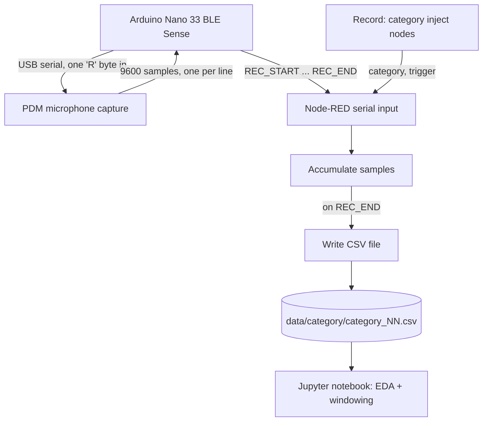

Recording is a request/response exchange over the same serial line, not a continuous stream: Node-RED sends one byte, the board replies with one full recording, then both sides wait for the next request. See [Lab 7: Sound EDA Concepts](../tutorials/lab07-sound-eda-concepts.md) for why the data is structured this way and what EDA and windowing mean for a signal like this one.

## Requirements

| Item | Requirement |
| :---- | :---- |
| Board | Arduino Nano 33 BLE Sense, original revision (onboard MP34DT05 PDM microphone) |
| Cable | USB data cable, not a charge-only cable |
| Host OS | macOS, for the recording step (uses `say` to produce the words; see below for other platforms). Any OS for the notebook. |
| Docker | Not used in this lab |
| Node.js | 22.9 or later, required by Node-RED 5 |
| Arduino CLI | Any recent version, or Arduino IDE 2 |
| Python | 3.10 or later, for the notebook |

Estimated time: about 45 minutes, including a full 20-recording session. The notebook itself runs in under a minute.

## Procedure

### 1. Flash the board

Run these commands from `ch07-eda-dataset-prep`.

```sh
arduino-cli board list
arduino-cli compile --fqbn arduino:mbed_nano:nano33ble nano33-audio-capture
arduino-cli upload -p /dev/cu.usbmodemXXXX --fqbn arduino:mbed_nano:nano33ble nano33-audio-capture
```

The PDM library ships with the `arduino:mbed_nano` core already, no separate install. `arduino-cli board list` shows the board's port; use that port in the upload command.

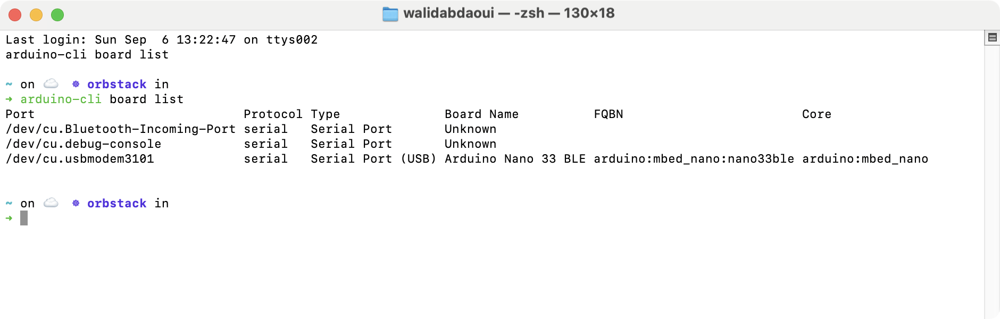

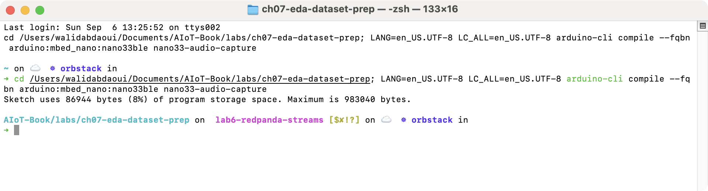

Close any serial monitor connected to the board before the next step. Node-RED needs the port to itself.

### 2. Start Node-RED

Run these commands from `ch07-eda-dataset-prep/nodered`.

```sh
npm install
./node_modules/.bin/node-red -s ./settings.js
```

Open `http://localhost:1880`. Double-click the `serial-port` config node, set its port to the one found in step 1, click **Done**, then **Deploy**. Node-RED runs in the foreground in this terminal; open a second terminal for the remaining steps.

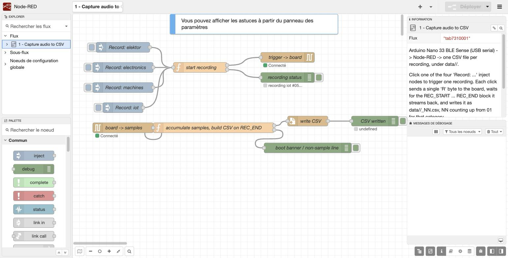

### 3. Record one sound

In the editor, click **Record: elektor**. Say a word near the board within about a second (the firmware waits 200ms after the trigger before it starts capturing, then records for 600ms). The debug sidebar's `recording status` entry confirms which recording just started; a new file appears under `data/elektor/` a few seconds later, once the board finishes streaming its 9600 samples back over serial.

```sh
find data -name "*.csv" | sort
```

Repeat for `Record: electronics`, `Record: machines`, and `Record: iot`. Each inject node keeps its own counter, so five clicks on the same node produce `_01.csv` through `_05.csv`.

### 4. Record the full dataset

Clicking twenty times by hand works, and is worth doing at least once to see the mechanism. `record_dataset.py` automates it: it fires each inject node over Node-RED's HTTP API and, in the same step, speaks the matching word with macOS's `say`, so the sound and the board's capture window line up without a person clicking and talking at the same time.

Run this from `ch07-eda-dataset-prep`, with Node-RED already running and freshly started (so its per-category counters begin at zero):

```sh
python3 record_dataset.py
```

```
OK    elektor_01  n=9600  overall_rms= 325.2  peak_rms=  595.3
OK    elektor_02  n=9600  overall_rms= 315.6  peak_rms=  577.4
...
OK    iot_05  n=9600  overall_rms= 363.2  peak_rms=  603.1

--- recordings at or below peak_rms 150 (likely missed the word) ---
none
```

Example output. `peak_rms` is the loudest 50ms window in the recording; a value at or below the printed threshold usually means the word and the capture window did not line up, and that one recording is worth deleting and retaking. This is how the 20 recordings shipped under `data/` were made.

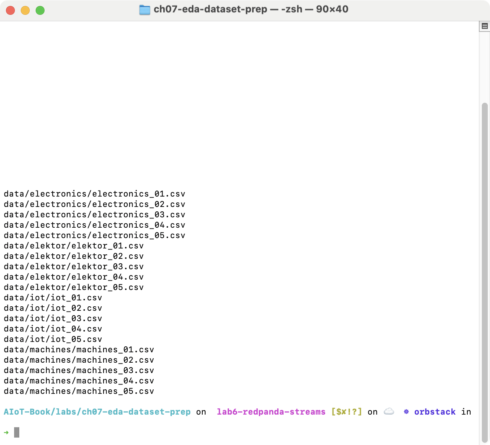

On Linux or Windows, replace the `say` call in `record_dataset.py` with another way to play a sound near the microphone; the Node-RED side of the script does not depend on macOS.

### 5. Run the notebook

Run these commands from `ch07-eda-dataset-prep/notebook`.

```sh
python3 -m venv .venv
./.venv/bin/pip install -r requirements.txt
./.venv/bin/jupyter notebook audio_eda.ipynb
```

Run the notebook top to bottom. It loads all 20 recordings, checks they are the length the firmware promises, plots one raw waveform per category, then introduces windowing: splitting each recording into short overlapping slices and computing energy and zero-crossing rate per slice.

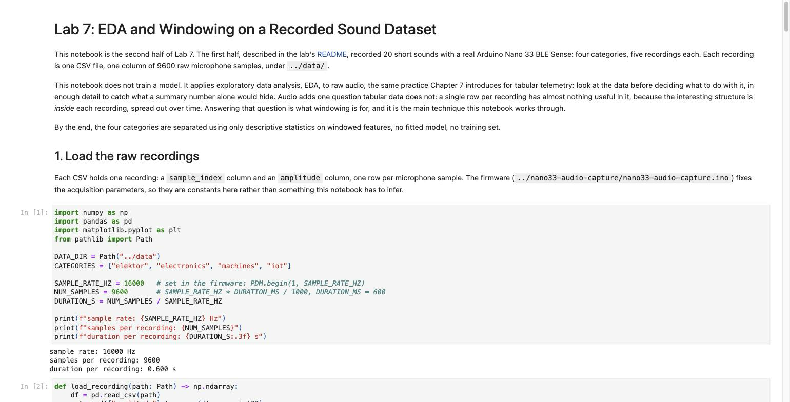

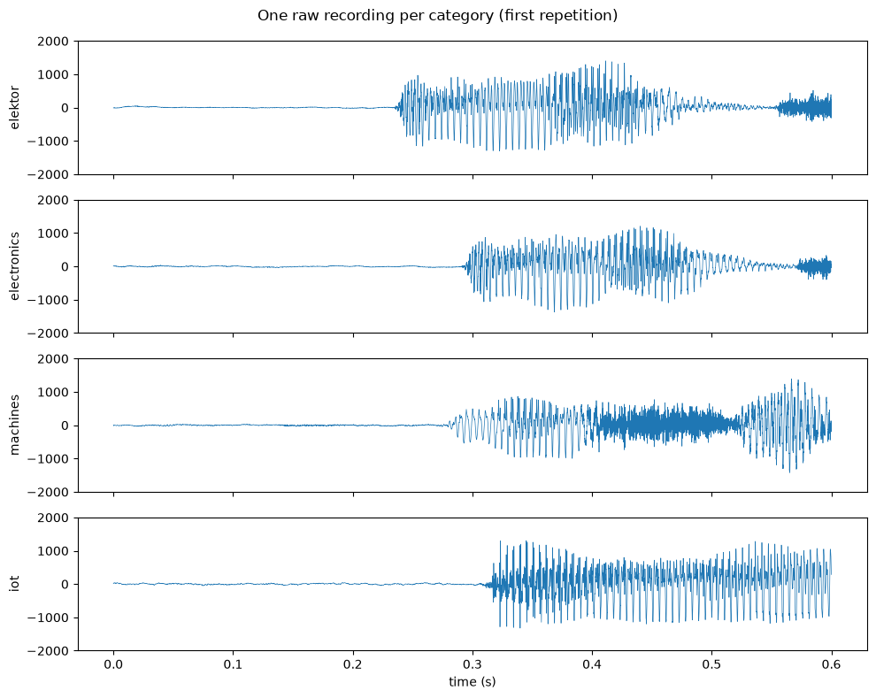

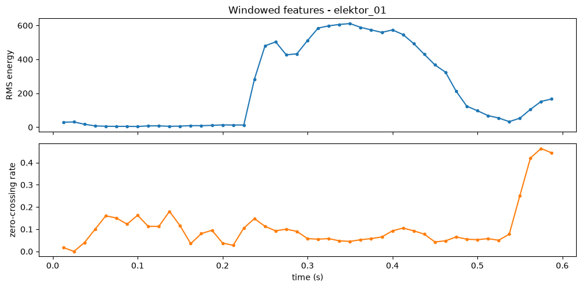

The notebook then collapses each recording's windows into three summary features and compares them across categories.

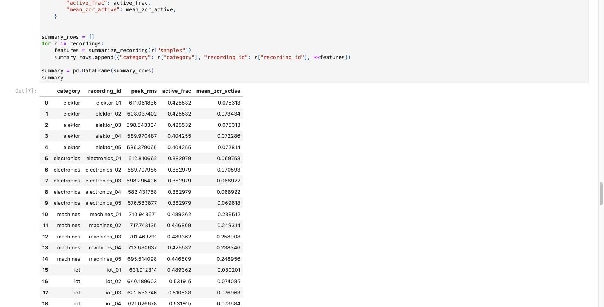

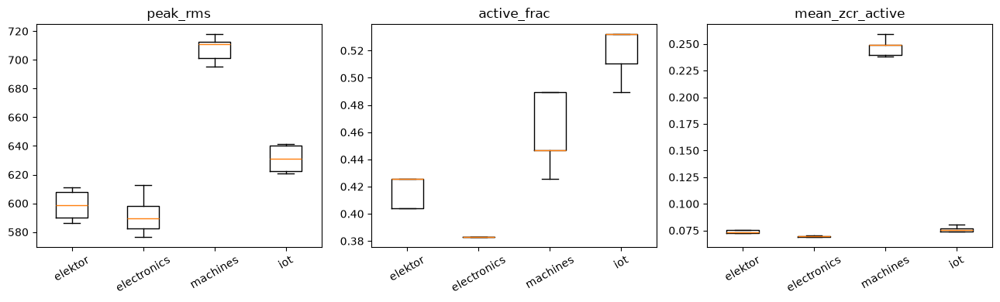

### 6. Distinguish the categories without machine learning

The notebook's last section assigns each recording to the category whose feature centroid, mean, is closest, computed leave-one-out so a recording is never compared against a centroid it contributed to. Nothing is fitted or trained: a centroid is a group mean, already visible in the table from step 5.

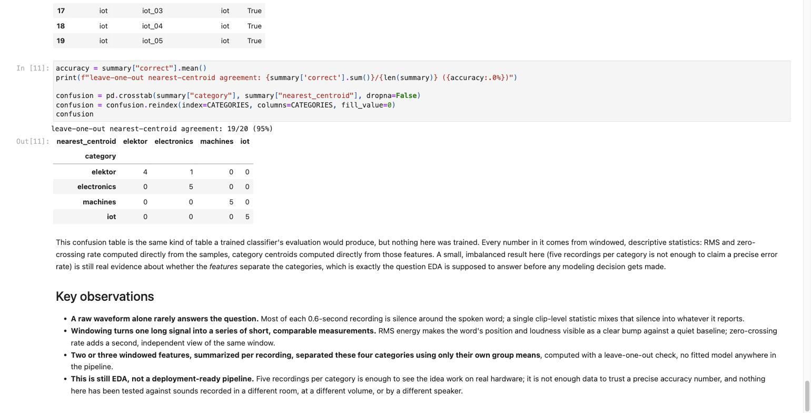

On this book's own dataset, this simple check placed 19 of 20 recordings correctly, using only the features from step 5. Five recordings per category is not enough to trust a precise accuracy number, and this is not a claim that generalizes past this dataset, but it is real evidence that windowed features, not the raw waveform, are what separates these sounds.

## Troubleshooting

| Symptom | Check | Action |
| :---- | :---- | :---- |
| Serial node stays disconnected | Port path in the `serial-port` config node, and whether another program holds the port | Close any serial monitor, correct the port, redeploy |
| `record_dataset.py` reports `FAIL ... did not appear` | Whether Node-RED and the board are both reachable | Confirm the flow is deployed and the serial node shows `Connecté` |
| A recording's `peak_rms` is weak | Timing between the trigger and the spoken word, or system output volume | Raise the Mac's output volume; move the board closer to the speaker; retake that one recording |
| `arduino-cli compile` fails to find `PDM.h` | Wrong core installed | `arduino-cli core install arduino:mbed_nano` |
| Notebook's recording count assertion fails | Fewer than 20 CSV files under `data/` | Finish recording all five repetitions for all four categories first |
| `jupyter notebook` command not found | Dependencies not installed into the virtual environment | Re-run `./.venv/bin/pip install -r requirements.txt` |

## Further experiments

- **Add a fifth category.** Add its four folders' worth of recordings, add its name to `CATEGORIES` in the notebook, and check whether the same three features still separate it from the rest, or whether a new feature is needed.
- **Change the window length.** `WINDOW_LEN` and `HOP_LEN` are set once, near the top of the notebook's windowing section. A much longer window smooths over the word's own internal structure; a much shorter one makes zero-crossing rate noisier. Both are visible directly in the RMS/ZCR plot.

## Key takeaways

Exploratory data analysis on a signal is not exploratory data analysis on a table with an extra dimension. A recording's raw amplitude, taken as one long array, mostly hides the thing worth measuring inside a mix of silence and noise; windowing is what turns "one long signal" into "a series of short, comparable measurements" that a plot or a statistic can actually use.

A handful of interpretable, windowed features, computed with nothing but arithmetic, can separate categories that a single global statistic cannot. Distinguishing sounds does not require a trained model to start; it requires the right representation of the signal, which is exactly the question EDA exists to answer before any modeling decision gets made.

A leave-one-out group-mean comparison is not a substitute for a trained, validated classifier, and this lab does not present it as one. What it demonstrates is narrower and just as useful: that the features an EDA pass produces are already doing real separating work, which is the evidence a later modeling decision (Chapter 10) should be built on, not skipped past.
